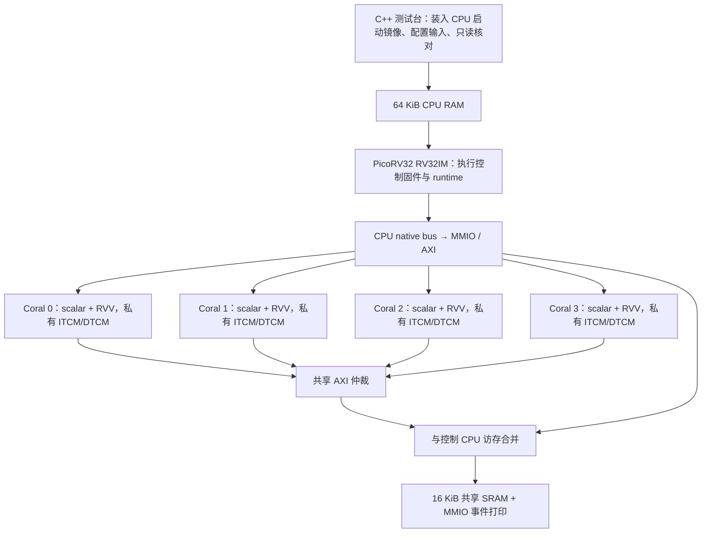

# 单控制核 + 四 Coral：架构、边界与后续任务

建模分支：`feat/ncoral-model`。它继承 `feat/ncoral` 的 RVV 单 die 原型，学习重点是控制核固件、核内算子、编译器与多核 runtime 的配合。目前控制 CPU 是真实 PicoRV32 RTL，不是高性能大核；四个 Coral 也是实际 RTL 实例。

## 已完成的系统

各核具有标量执行前端，因此 Coral kernel 本身也执行 RISC-V 标量地址计算和控制流；RVV 负责向量计算。当前 VLEN=128，算子使用 e32,m1，最多同时计算四个 int32 元素。VME/Zvt 未开启。

| 模块 | 已有行为 | 代码 |
|---|---|---|
| 控制 CPU | 从启动 RAM 运行 RV32IM 固件，无宿主 C++ 代替调度 | `die/Die.scala`、`die/vendor/picorv32/` |
| 四核集群 | 每核独立复位、入口、ITCM/DTCM，轮转 AXI 仲裁 | `Cluster.scala` |
| 软件 runtime | 加载 kernel、参数下发、按行切分、核组启动、轮询等待、异常检测 | `die/firmware/runtime.c` |
| 算子 | 四核向量加法；GEMM+bias+ReLU；3×3 卷积+bias+ReLU | `device/add.c`、`device/complex.c` |
| 依赖与并行 | 两次加法依赖串行；GEMM/卷积固定核组的串行、并行演示 | `die/firmware/main.c`、`complex_demo.c` |
| 可观察性 | MMIO 日志、RTL 周期戳、RVV MAC 派发计数、mcycle/minstret 采样、交互时间线 | `Die.scala`、`device/profile.h`、`die/profile_check.h` |
| 验证 | 独立 int64 参考、逐元素、保护字、输入不变、trap/fault、顺序/重叠和错误注入 | `die/complex_check.h`、`tools/die/check.py` |
| 构建入口 | 环境检查、仿真器与软件分开构建、IR/汇编/ELF、统一运行和回归 | `tools/ncoral.py` |

### 地址与启动契约

以下为控制 CPU 视角。每核地址窗会翻译为该 Coral 本地地址，不能把不同核相同的 DTCM 地址误认为同一块共享内存。

| 地址 | 用途 |
|---|---|
| `0x00000000..0x0000ffff` | 控制 CPU RAM；固件链接占前 48 KiB |
| `0x0000ff00` | 启动配置，包含场景、行数和等待预算；栈从该地址向下增长 |
| `0x20000000..0x20003fff` | 共享 SRAM，最后 16 字节保留为事件端点 |
| `0x20003ff0` | kernel 写入事件日志 |
| `0x40000000 + core*0x100000` | Coral 0..3 的 host 地址窗，只有指定子区域有效 |
| 核地址窗 `+0x00000..0x01fff` | 对应核 8 KiB ITCM |
| 核地址窗 `+0x10000..0x17fff` | 对应核 32 KiB DTCM，起始 256B 用于参数 |
| 核地址窗 `+0x30000` | 核复位/时钟门控控制；`+4` 为入口 PC |
| `0x50000000..0x5000002f` | 系统 ID、WFI、fault、完成码、周期、错误、checksum 等状态 |

启动过程：测试台填入 CPU RAM和配置 → 释放控制 CPU → 固件通过 MMIO 向四核 ITCM 写镜像 → 向私有 DTCM 写参数 → 启动核组 → kernel 计算、写 done 并进入 WFI → CPU 检查和上报 → 测试台独立读共享 SRAM 验证。测试台不向 Coral 下发算子。

## 还没有完成的工作

### P1：使 runtime 从固定演示发展为可编程调度

现在没有通用命令队列、动态核分配、异步事件、DAG 调度、任务抢占或中断完成通知。双算子演示中 GEMM 固定核 0/1、卷积固定核 2/3；新增单算子入口可让 GEMM 或卷积使用全部四核。提交计划仍写在 C 固件中，LLVM 不会自动把一个算子变成四核任务。

下一步先实现固定大小任务描述符：`kernel_id / core_mask / 输入输出地址 / 分片范围 / wait_event / signal_event / status`。在控制核上维护静态容量的队列和事件表；以已有 MMIO 启动和等待函数为底层，先不增加动态内存分配。在已有四核单算子、双算子 2+2 分组、前驱依赖和空分片用例基础上，增加队列资源冲突和任务失败不释放成功事件的验证。

### P2：私有指令与 LLVM 学习路线

当前代码使用系统 Clang 17 的标准 RVV，没有本项目新增的私有指令，也没有 `-mcpu=coral`。本分支不把 Zvt 支持当作已经接通的能力。

可在配套 `coralnpu-compiler`/LLVM 工作区建立明确版本的私有 `Xcoral` 扩展：先定义一个 GPR 操作数的简单计算指令，再做 feature、编码、汇编/反汇编、intrinsic 和指令选择，最后注册 `coral` CPU 型号默认启用 feature。同步修改 Coral 解码执行或先提供指令解释器，做到 C/IR → 机器码 → 执行结果闭环；只让 objdump 显示助记符不算执行通过。保持基础 RV32 和 ABI，私有指令使用一致的编码；以后扩展到矩阵状态时再增加状态依赖和保存恢复规则。

配套 Coral Zvt 补丁可作为参考，但它不是目前四核 RVV 仿真器的前置依赖。编译器 feature 与硬件能力须匹配。独立编译器仓库的修改不属于本分支已实现内容。

### P3：程序加载、内存与互联

现有 kernel 是嵌入控制固件的 ITCM-only 镜像，设备启动不通用初始化 `.data/.bss`。需要定义 ELF 多段加载与 kernel ABI 版本，处理重定位或明确固定地址；再引入共享缓冲分配、生命周期和访问边界检查。

互联是功能性的共享 AXI 仲裁，读、写方向分别串行化 outstanding 事务，未完成高吞吐 NoC、DMA、DDR/HBM 控制器、缓存一致性和带宽/延迟校准。先增加可配置外存和 DMA tile 搬运，区分片上数据复用与共享带宽竞争，再评估是否需要多 outstanding 或多 bank。现有 stall-period 是背压注入参数，不是现实 HBM 性能模型。

### P4：算子库与模型推理

当前算子形状有限，数值为小幅值 int32；没有 BF16/FP16 算子数值验证、INT8/INT4 量化、Softmax、RMSNorm、RoPE、Attention、KV cache、权重加载、tokenizer 或自回归循环。因此目前不能声称能跑 Qwen/Gemma。

建议先完成可独立测试的线性层、RMSNorm、RoPE、Softmax、Attention、SiLU/门控乘，再用很小的 decoder block 比对参考输出；随后增加权重格式与模型前端，验证 prefill 和 decode，最后选择内存容纳得下的小模型。完整大模型在 RTL 上速度可能过慢，需要与相同 ABI 的快速功能模型配合；RTL 保留小尺寸 kernel/调度回归。

### P5：更接近芯片产品的建模

当前是单时钟、单 die 功能 RTL，没有高性能控制大核、操作系统、完整异常/中断恢复、功耗管理、CDC、物理面积/时序签核、3D 堆叠链路或多卡通信。它们需要各自的接口、时序和故障模型，不能通过把四核画在一张图里获得。

优先顺序建议为 **任务队列与事件 → 私有指令闭环 → 数据搬运与更多算子 → 小 Transformer → 多卡/3D 性能模型**。每个阶段继续复用当前串并行、边界和异常回归。RVV 派发计数是执行证据，MMIO 日志有开销，当前周期结果不能直接推算云端吞吐。

## 如何开始修改

运行命令与编译产物见 [编译与运行](build_and_run.md)。历史 19 项 RVV 通过记录位于 [verification.json](verification.json)；它记录的是先前验证，本分支新增入口的实际检查另记于 [建模分支验证](model_validation.md)。后续功能应各自记录测试输入、参考结果、源码/二进制版本和完成状态。
